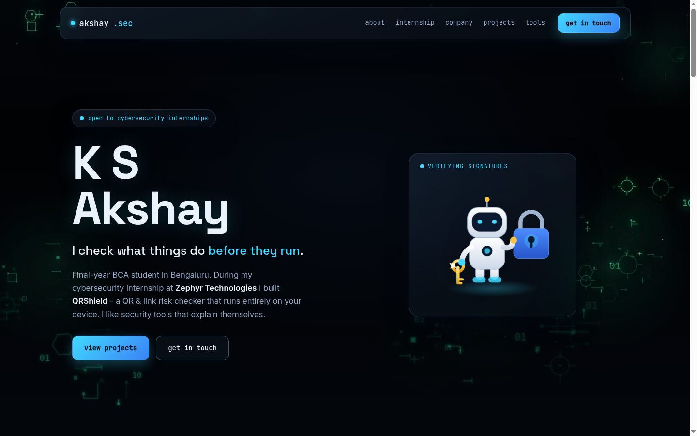

# K S Akshay - cybersecurity portfolio (final design)

Single static page: `index.html` + `style.css` + `main.js` + the background layer.

## Design references (no assets copied)
- Background: original HUD-field animation matching a UXMEE "AI Website Design"
  concept pin (https://pin.it/4MVrrNHI2) - black, neon-green glowing HUD patches,
  depth of field, rise/rotate/pulse. Two original implementations live here:
  `bg-field.js` (real-time canvas, used as fallback) and `assets/bg-loop.mp4`
  (an original render of the same field at 1080p, used as the primary background
  video with a poster fallback). Neither contains any frames from the pin.
- Foreground language: robot + gold key + padlock hero, glass cards, navy/teal
  palette, in the spirit of Sheikh Shovon's "CyberSecurity Solution Landing Page"
  (https://pin.it/3iy7frADX). The robot/key/padlock illustration is original
  inline SVG drawn for this page; no artwork was taken from the pin.

## Notes
- prefers-reduced-motion: background video is hidden (poster/static), robot and
  scroll animations are disabled, all content stays visible.
- Honest content only: real projects, real numbers, forks labeled as forks.
- All project images in `assets/` are real captures: QRShield live app, rakshex.in,
  the GitHub repos, and the forked gophish dashboard. The cyber-lab card shows
  verbatim terminal output from a real run of `security-auditor.py`.
- VendorGuard: the demo deployment from the hackathon is currently offline, so the
  card links the source only - no dead demo link on the page.

## Live

https://akshay-sec.vercel.app



## Run locally

Static site, no build step:

```sh
python3 -m http.server 8000
# open http://localhost:8000
```
